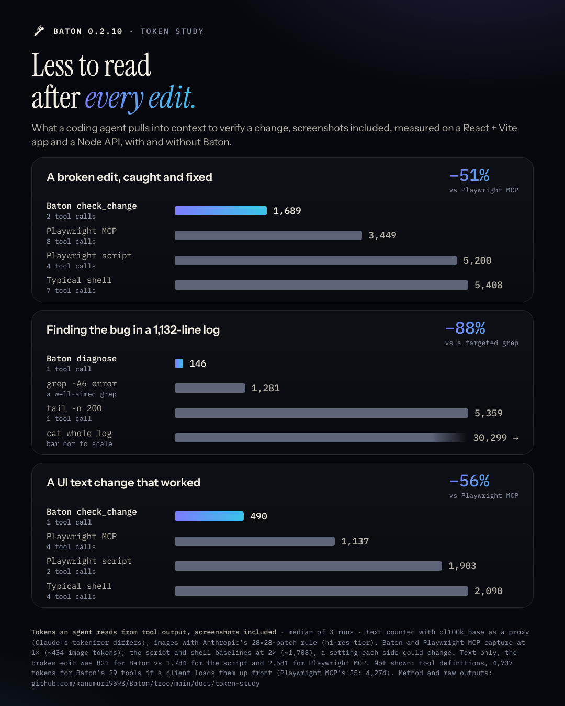

# Token study: what an agent reads to check its own edit

How many tokens does a coding agent pull into its context to verify a change, with Baton and without it?
This page has the method, the results for baton-run **0.2.10**, the **0.2.9** baseline they replaced, the
caveats, and everything needed to recount or rerun it.



## Results (baton-run 0.2.10)

Tokens are what the tools *return* to the agent: tool-output text counted with `cl100k_base` (a proxy, see
[Tokenizers](#tokenizers)) plus screenshot image tokens (Anthropic's 28×28-patch rule, high-resolution tier).
Medians of 3 runs. Lower is better. Percentages are against each baseline, rounded down.

| Scenario | Baton | Playwright MCP | Playwright script | Typical shell |
|---|---|---|---|---|
| 1. UI text edit that worked | **490** (`check_change`, 1 call) | 1,137 (4 calls), −56.9% | 1,903 (2 calls), −74.2% | 2,090 (4 calls), −76.5% |
| 2. Broken edit (`bannr is not defined`), fix, confirm | **1,689** (`check_change` ×2) | 3,449 (8 calls), −51.0% | 5,200 (4 calls), −67.5% | 5,408 (7 calls), −68.7% |

| Scenario | Baton `diagnose` | `grep -A 6` | `tail -n 200` | `cat` whole log |
|---|---|---|---|---|
| 3. Find the bug in a 1,132-line service log | **146** (1 call) | 1,281, −88.6% | 5,359, −97.2% | 30,299, −99.5% |

Text only (no screenshots), the broken edit was 821 tokens for Baton against 2,581 for Playwright MCP (−68.1%),
1,784 for the script (−53.9%) and 1,992 for the typical shell (−58.7%).

**Fixed cost, not in the tables:** Baton's 29 MCP tool definitions are **4,737 tokens** if the client loads them all
up front (Playwright MCP's 25 tools: 4,274). Clients that defer tool schemas (tool search) pay much less. The shell
baselines have no schema cost, but the agent writes the Playwright script once (about 270–320 output tokens).
Against the script and grep baselines, the 4,737 tokens are earned back after about 2 broken-edit cycles,
4 happy-path cycles or 5 log investigations.

Full table with every approach, tool-call counts, the legacy Claude tokenizer cross-check, per-step numbers and
agent-written call tokens: [`results-tables.md`](results-tables.md). Machine-readable: [`results.json`](results.json).

### What changed from 0.2.9

Same harness and labs. The 0.2.10 changes ([#29](https://github.com/kanumuri9593/Baton/pull/29)) are 1× web
screenshots by default, text-only web checks that load the page, a `read_logs` filter that searches the whole
buffer, and a compact `diagnose`.

| Scenario, Baton approach | 0.2.9: text / incl. images | 0.2.10: text / incl. images | Change incl. images |
|---|---|---|---|
| 1. Happy edit, `check_change` | 55 / 1,763 | 56 / 490 | −72.2% |
| 2. Broken edit, `check_change` ×2 | 828 / 4,244 | 821 / 1,689 | −60.2% |
| 2. Broken edit, `check_change` ×2, `screenshot: false` | 42 (said OK on a crashing page) | 752 (NOT OK, reports `bannr is not defined`) | correct now |
| 3. Log bug, `diagnose` | 1,416 | 146 | −89.7% |
| 3. Log bug, `read_logs` filter, `tail: 5000` | 322 | 322 | same |
| 3. Log bug, `read_logs` filter, default tail | not measured | 322 (all 14 matching lines) | filter searches the whole buffer |

The baselines were re-run too and came within 30 tokens of the 0.2.9 run.

### 0.2.9 baseline, for comparison

All medians, from [`baseline-0.2.9/results.json`](baseline-0.2.9/results.json) (tables:
[`baseline-0.2.9/results-tables.md`](baseline-0.2.9/results-tables.md)). Scenario 4 was measured only on 0.2.9.

| Scenario | Approach | 0.2.9 calls | 0.2.9 text | 0.2.9 total | 0.2.10 calls | 0.2.10 text | 0.2.10 total |
|---|---|---|---|---|---|---|---|
| 1. Happy edit | Baton MCP `check_change` | 1 | 55 | 1,763 | 1 | 56 | 490 |
| | Baton MCP, `screenshot: false` | 1 | 21 | 21 | 1 | 21 | 21 |
| | Baton CLI `baton check --json` | 1 | 93 | 93 | 1 | 94 | 94 |
| | Playwright MCP | 4 | 704 | 1,138 | 4 | 703 | 1,137 |
| | Playwright script | 2 | 195 | 1,903 | 2 | 195 | 1,903 |
| | Typical shell | 4 | 382 | 2,090 | 4 | 382 | 2,090 |
| 2. Broken edit | Baton MCP `check_change` ×2 | 2 | 828 | 4,244 | 2 | 821 | 1,689 |
| | Baton MCP, `screenshot: false` | 2 | 42 | 42 | 2 | 752 | 752 |
| | Baton CLI | 2 | 920 | 920 | 2 | 913 | 913 |
| | Playwright MCP | 8 | 2,611 | 3,479 | 8 | 2,581 | 3,449 |
| | Playwright script | 4 | 1,811 | 5,227 | 4 | 1,784 | 5,200 |
| | Typical shell | 7 | 2,019 | 5,435 | 7 | 1,992 | 5,408 |
| 3. Log bug | Baton `diagnose` | 1 | 1,416 | 1,416 | 1 | 146 | 146 |
| | Baton `read_logs` filter, `tail: 5000` | 1 | 322 | 322 | 1 | 322 | 322 |
| | Baton `read_logs` filter, default tail | – | – | – | 1 | 322 | 322 |
| | `grep -n -i -E "error\|exception" -A 6` | 1 | 1,253 | 1,253 | 1 | 1,281 | 1,281 |
| | `tail -n 200` | 1 | 5,355 | 5,355 | 1 | 5,359 | 5,359 |
| | `cat` whole log | 1 | 30,271 | 30,271 | 1 | 30,299 | 30,299 |
| 4. Start a two-service workflow | Baton `run_workflow` | 1 | 196 | 196 | – | – | – |
| | One shell command (start, wait, print logs) | 1 | 30 | 30 | – | – | – |
| | Step by step (start, poll, start, poll) | 4 | 54 | 54 | – | – | – |

On 0.2.9, Baton's 2× phone screenshot (1,708 image tokens) made it 22% more expensive than Playwright MCP once images
were counted, `diagnose` cost about as much as a well-aimed `grep`, and Baton's tool definitions were 4,536 tokens.
Scenario 4 favours the shell: Baton's `run_workflow` reply is longer than a one-liner's, and that has not changed.

## Method

### Setup

- Two identical copies of each lab: `A/` run under Baton, `B/` run by hand. Same edits on both, same path lengths,
  loopback only. Each run uses its own `BATON_HOME`.
- **Web lab** ([`lab/web-lab`](lab/web-lab)): React 18.3.1 + Vite 6.3.5, a small delivery tracker page. Baton runs it
  from `.vscode/launch.json` (`npm run dev`, `batonKind: web-dev`). The baseline runs `npm run dev` in the background
  with output to `dev.log`.
- **Log lab** ([`lab/log-lab`](lab/log-lab)): a plain Node orders API with request logging, a real bug
  (`GET /api/orders/13` throws `TypeError: Cannot read properties of undefined (reading 'net')`) and a flaky upstream.
  A deterministic traffic script sends 640 requests, giving a 1,132-line log with 7 unhandled exceptions (each a
  7-line stack on stderr) and one upstream timeout warning.
- **Workflow lab** (0.2.9 only): `examples/workflow-lab` from the baton-run package.
- Before measuring, both sides load the page once (unmeasured warm-up) so Vite's first-load dependency optimisation
  does not land on one side only.
- Linux, Node 24, Chromium 141 via Playwright 1.56.1, `@playwright/mcp@0.0.82`.

### What counts

- **Text tokens**: the exact text a tool returned (MCP `text` content, or a shell command's combined stdout and
  stderr). Saved as `raw/run-N/<scenario>/<approach>/NN-step.out.txt`; the exact call is next to it as `.call.txt`.
- **Image tokens**: each image a tool returned, or the agent opened, saved as `…img-1.png`. Counted with Anthropic's
  rule: one visual token per 28×28 patch, `ceil(w/28) × ceil(h/28)`, after resizing to the model's limit
  (high-resolution tier: 2,576 px long edge, 4,784 tokens). Source:
  [Claude docs, Vision](https://platform.claude.com/docs/en/build-with-claude/vision), fetched 2026-10-11.
  A 390×844 capture is 14 × 31 = **434** tokens; a 780×1688 (2×) capture is 28 × 61 = **1,708**.
- **Tool calls**: each call the agent makes, including reading a screenshot or a snapshot file.
- **Not counted**: the agent's own reasoning, the edit itself (identical on both sides), framing overhead around
  each tool result (more calls means more overhead, so leaving it out favours the baselines), and re-reading earlier
  tool output on later turns.

### Tokenizers

- Primary: `cl100k_base` via `gpt-tokenizer@3.0.1`, a stated proxy.
- Cross-check: the legacy Claude tokenizer, `@anthropic-ai/tokenizer@0.0.4` (pre-Claude 3); its column is in
  `results-tables.md`. The two agree on the ratios within a few points.
- Neither is the tokenizer of current Claude models. Absolute counts are approximate; the ratios are the useful part.

### Approaches

All commands are in [`harness/measure.mjs`](harness/measure.mjs); every call's exact text is in `raw/…/*.call.txt`.

- **Baton, scenarios 1–2**: MCP `check_change {"session": "web-lab/web-lab", "viewport": "phone"}`, which returns a
  text verdict plus the screenshot inline. Also measured: the same with `screenshot: false`, and the CLI
  `baton check web-lab/web-lab --viewport phone --json`.
- **Playwright script**: [`harness/check.mjs`](harness/check.mjs) (headless Chromium, phone viewport at 2×, prints
  console messages, page errors, failed requests, HTTP ≥ 400 and the visible text), then reading the PNG.
- **Playwright MCP** (`--headless --isolated --viewport-size 390x844`): `browser_navigate`, reading the snapshot file
  it saves, `browser_console_messages`, `browser_take_screenshot`.
- **Typical shell**: the new dev-server output (`tail -n +K dev.log`), `curl -s` of the page, then the script and the
  PNG. The dev server and `curl` both looked normal while the page was blank.
- **Baton, scenario 3**: `diagnose {"sessions": ["orders-api/orders-api"]}`, and `read_logs` with
  `filter: "error|exception"` (with `tail: 5000`, and with the default tail).
- **Without Baton, scenario 3**: `tail -n 200 server.log`, `cat server.log`,
  `grep -n -i -E "error|exception" -A 6 server.log`.
- **Scenario 4** (0.2.9 only, [`harness/measure-0.2.9.mjs`](harness/measure-0.2.9.mjs)): `run_workflow` with the two
  steps from `workflow.json`, against one shell command that starts both services and waits for them, and against
  start/poll/start/poll.

The 0.2.10 numbers were measured on the `claude/lean-agent-output` build (commit 6cdb238) before it was merged as #29
and released as 0.2.10; its source differs from the release only in sample-app names in help text and tests.

## Caveats

1. **Tokenizer is a proxy.** `cl100k_base` is not Claude's tokenizer; absolute numbers will differ.
2. **Tool definitions cost tokens.** Baton's 29 tool schemas are 4,737 tokens per session if loaded eagerly
   (Playwright MCP's: 4,274). The per-check savings have to pay that back first (see Results).
3. **Screenshot resolution is a setting.** Baton 0.2.10 and Playwright MCP capture at 1× (434 image tokens); the
   Playwright script and typical-shell baselines capture at 2× (1,708), which is the script's own setting. A script
   capturing at 1× would cost 1,274 fewer tokens per screenshot. The text-only comparisons do not depend on this.
4. **One small app and one log.** The page is tiny and the bug is a single runtime error. Larger pages make
   Playwright MCP's snapshot and the script's text dump grow, while Baton's OK line does not; a page with many console
   errors makes every approach grow. React's development build logs each render error several times with long stacks,
   which every approach (Baton included) passes on.
5. **Baselines could be leaner.** A script that prints only errors would return about as little text as Baton on the
   happy path, and an agent could skip reading the screenshot.
6. **`diagnose` is compact, not complete.** It returned 2 findings (the error line and the `TypeError` with its top two
   frames, `+3 more frames`) instead of every stack line. That was enough to find the file and line here; a bug whose
   cause is deeper in the stack may need a `read_logs` call.
7. **Scenario 4 favours the shell** and was not re-run for 0.2.10; Baton's value there is supervision, which is not a
   token count.
8. **Correctness and time are not measured.** The typical-shell path's dev-server output and `curl` both looked healthy
   on a blank page; an agent that stopped there would have reported success.
9. **Single machine, Linux, headless Chromium.** iOS, Android and Flutter were not measured.

## Raw data

- [`raw/`](raw): every call and every output of the 0.2.10 run (3 runs), the screenshots each approach returned, the
  call index `calls.json`, and the tool schemas of both MCP servers. About 3.2 MB.
- The 0.2.9 run's raw outputs (another 3.6 MB) are not included, to keep the repository small; its summary is in
  [`baseline-0.2.9/`](baseline-0.2.9), and `BATON_VERSION=0.2.9 ./reproduce.sh` regenerates them.
- The raw outputs contain the absolute paths of the measurement sandbox (a generic `dev` account,
  labs under `~/af/projects`). They are left as captured because path length is part of the measured text.

## Reproduce

Needs Node.js 24+, npm, curl, `fuser` and a Chrome or Chromium binary. Linux or macOS.

```bash
cd docs/token-study
CHROME=/path/to/chrome ./reproduce.sh                       # baton-run 0.2.10, 3 runs
RUNS=5 CHROME=/path/to/chrome ./reproduce.sh
BATON_VERSION=0.2.9 CHROME=/path/to/chrome ./reproduce.sh   # the 0.2.9 baseline, with scenario 4
```

It installs `baton-run` globally at the chosen version, puts the other pinned tools under `~/baton-token-study`, uses
its own `BATON_HOME`, and writes `rerun/raw`, `rerun/results.json` and `rerun/results-tables.md` (the committed
results are left alone). It needs ports 5174–5175, 43121–43122, 43141–43142 and 43150–43151 free on 127.0.0.1.

To recount the committed outputs without rerunning (this rewrites `results.json` and `results-tables.md` next to
`raw/`):

```bash
TOK=<dir with gpt-tokenizer@3.0.1 and @anthropic-ai/tokenizer@0.0.4 in node_modules> node harness/count.mjs raw
```

To redraw the chart from `results.json` (needs Playwright; `PW` is a dir with `node_modules/playwright`):

```bash
PW=~/baton-token-study/tools/pw CHROME=/path/to/chrome node harness/render-card.mjs results.json .
```
